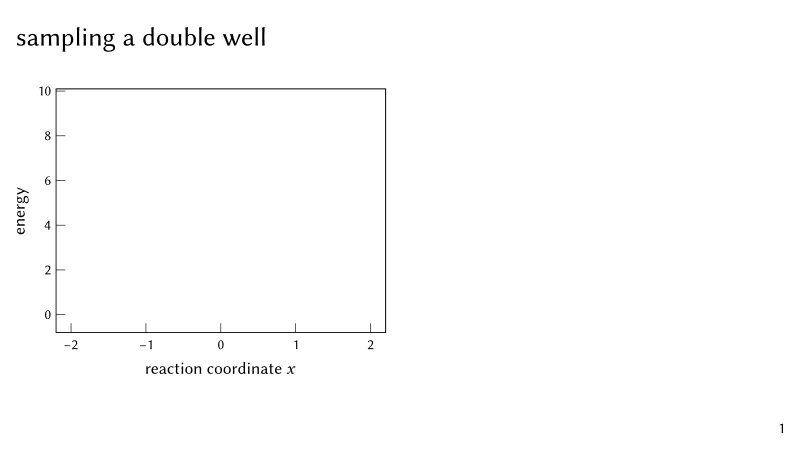
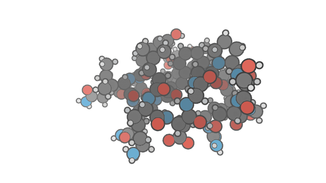
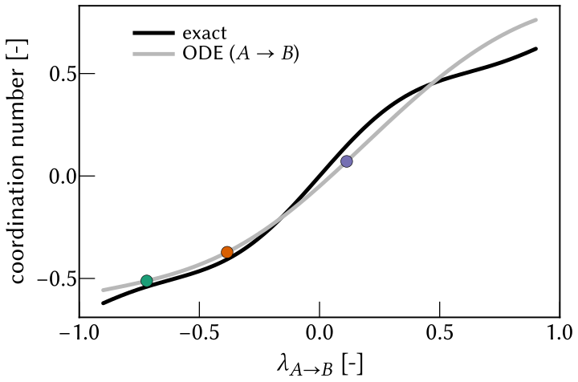

# llandau

Scientific slides drawn live, with interactive 3D trajectories inside them. A deck is
written like a [manim](https://www.manim.community) scene and plays straight from the
code (wgpu): no videos, no render step, and stepping back or scrubbing is instant. The
same plots save as paper figures.

```
pip install llandau            # macOS and Linux wheels; text needs the typst CLI
```

## A deck



```python
from llandau import *

class Results(Deck):
    def construct(self):
        self.title("sampling a double well")
        ax = Plot(R.body.left, xlabel="$x$", ylabel="energy")
        profile = ax.plot(x, energy, label="$U(x)$")
        self.reveal(ax)                                   # frame and ticks
        self.reveal(profile, anim=Create)                 # the line draws itself
        self.reveal(place(text("$p(x) prop e^(-U \\/ k T)$"), R.body.right), anim=Write)

SLIDES = order(Results)
```

`llandau play examples/slides.py` presents it (arrows step, F full screen, the wheel scrubs);
`llandau pdf` and `llandau png` export one page per step.

## 3D trajectories



```python
viewer = Viewer().load(positions, numbers, roles=roles)    # (frames, atoms, 3), (atoms,)
viewer.style = "protein"
viewer.set_trails(segment_ids=segment_ids(t, boundaries))
viewer.color_by("deviation", np.linalg.norm(positions - positions[-1], axis=-1))
explore(viewer, plots={"rmsd": rmsd}, t=t)                 # a window; ? shows every key
```

The explorer's R key records what you do into an MP4. A deck shows the same viewer live on
chosen steps, with `self.live("name", R.body.right, camera={"azimuth": 30}, frame=60)`:
`llandau play examples/live_demo.py`.

## Paper figures



```python
fig, ax = subplots(figsize=(3.0, 2.0))                      # inches, points, Typst math
ax.plot(lam, exact, color="k", label="exact")
ax.scatter(lam[i], ode[i], s=20, color="C1", zorder=50)
ax.set_xlabel("$lambda_(A -> B)$")
fig.savefig("ode.pdf")                                      # or .svg, .png
```

`examples/` has the decks and figures above; the modules' docstrings document the rest
(`python -c "import llandau; help(llandau)"`).
